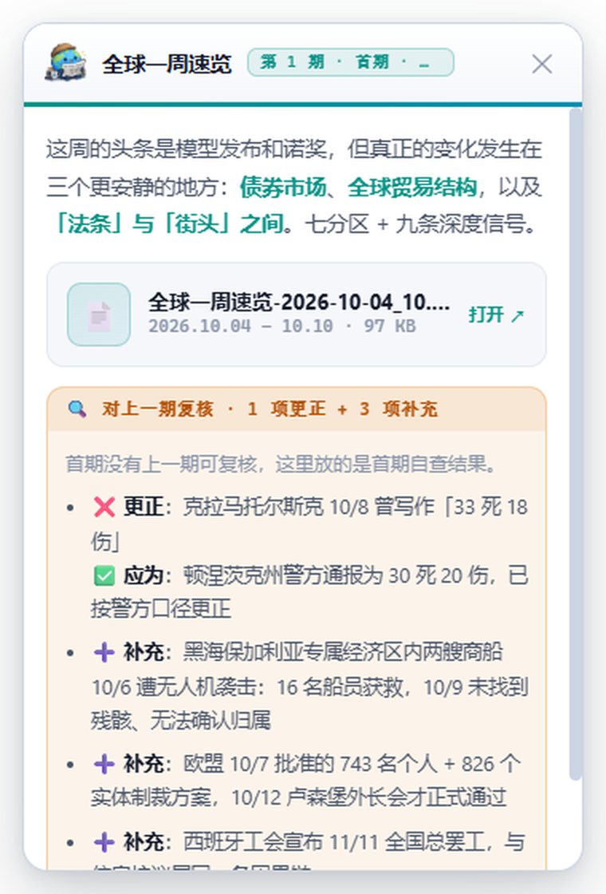
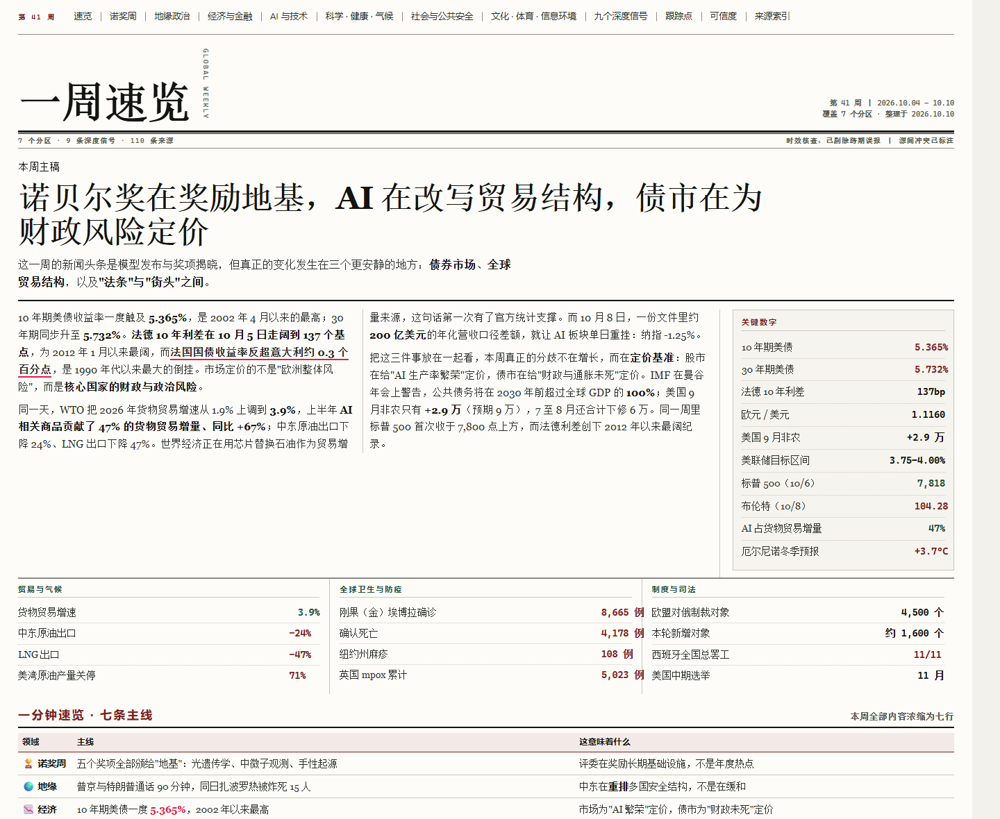

# 🌍 全球一周速览 · 桌宠

> 一个常驻桌面的地球小报童。每周日 20:00，它把「全球一周速览」推到你面前。
>
> **零后端、零服务器、零账号** —— 内容是你自己的 HTML 文件，它只负责按时端上来。

<p align="center">
  <b><a href="https://github.com/ATOM-del934/Newsie/releases/latest/download/Newsie-win32-x64.zip">⬇ 下载 Windows 免安装版</a></b>
  &nbsp;·&nbsp;
  <b><a href="https://atom-del934.github.io/Newsie/">▶ 在线试用网页版</a></b>
  <br><sub>下载即用，不需要装 Node.js。仅 Windows x64；网页版任何系统都能开。</sub>
</p>

<p align="center">
  &nbsp;&nbsp;&nbsp;
  
</p>

**English** · A desktop pet that delivers a weekly news digest as a local HTML file
every Sunday at 20:00. Two builds: a zero-install web page, and an Electron tray app
that keeps working after you close the window. No server, no account, no network calls.
Jump to the [English summary](#english-summary).

左边的桌宠常驻桌面，可拖动，还会自己换姿势；右边的气泡就是每周日 20:00 弹出来的东西 ——
一句话摘要、可直接打开的速览文件，以及**对上一期的复核结果**。

---

## 两个版本，二选一

| | 网页版 | 托盘版 |
|:--|:--|:--|
| 入口 | `index.html`（双击） | `electron-tray/启动.cmd`（Windows）<br>`pnpm start`（macOS / Linux） |
| 安装 | **不用装任何东西** | 需要 Electron（约 230 MB） |
| 关掉之后 | ❌ 不再推送，下次打开补投 | ✅ **照样准点推送** |
| 桌面桌宠 | ✅ 可拖动 | ✅ 可拖动 |
| 待机动作 | ✅ 会自动换姿势 | ✅ 会自动换姿势 |
| 系统通知 | 浏览器通知 | ✅ 原生通知 |
| 未读红点 | 页面内 📬 | ✅ 叠在托盘图标上 |
| 开机自启 | — | ✅ 菜单里勾选 |
| 适合 | 先试试看 | 长期常驻 |

**建议先开网页版**，10 秒就能看到效果；确定要长期用了再装托盘版。

---

## 快速开始

### ① 直接下载（Windows，最省事）

[**⬇ 下载 Newsie-win32-x64.zip**](https://github.com/ATOM-del934/Newsie/releases/latest/download/Newsie-win32-x64.zip)（约 140 MB）

解压到任意目录 → 双击 **Newsie.exe** → 托盘出现桌宠。

**不需要装 Node.js**，运行环境已经打进包里了。

> ⚠️ Windows 会弹出「已保护你的电脑」——因为作者没买代码签名证书（一年要几百到几千元），
> 所有免费的 Electron 应用都是这样。点 **更多信息** → **仍要运行** 即可。
>
> 如果托盘上看不到图标，可能是被 Windows 11 折叠进了 `^` 溢出区，点那个小箭头就能看到。

### ② 网页版（零安装，先试试看）

双击 `index.html`，或者[**在线试用**](https://atom-del934.github.io/Newsie/)。

桌面右下角会出现一只可拖动的桌宠。点它身上的 **📬** 看最新一期，
**📄** 用浏览器打开，**⋯** 打开设置。

> 网页版的限制：**关掉页面就不会推送**。想要「关掉也准点」请用 ① 或 ③。

### ③ 从源码跑托盘版（macOS / Linux 走这条）

需要先装 [Node.js](https://nodejs.org/)（自带 `npm`）与 [pnpm](https://pnpm.io/)。
用 `npm` 也行，把下面的 `pnpm` 换成 `npm` 即可。

```bash
git clone https://github.com/ATOM-del934/Newsie.git
cd Newsie/electron-tray
pnpm install      # 首次会下载 Electron，约 150 MB
pnpm start
```

**Windows** 也可以直接双击 `electron-tray/启动.cmd`。

启动后：

- **左键单击**托盘图标 → 弹出最新一期
- **左键双击** → 用浏览器打开
- **右键** → 菜单（下一次投递时间、预览气泡、开机自启、待机动画、清除红点…）

### 自己打包成 exe

```bash
cd electron-tray
pnpm install
pnpm run pack        # 产出 dist/Newsie-win32-x64/，含 Newsie.exe
```

### 如果 `pnpm start` 报「找不到 electron.exe」

`pnpm install` 显示成功，却启动失败？这是 pnpm 10 以上的一个坑：

> pnpm 出于安全考虑**默认不执行依赖的构建脚本**，而 Electron 的运行时
> （`electron.exe`）正是靠 `electron` 包自己的 postinstall 下载的。
> 脚本被拦掉 → 只装了空壳 → 启动时找不到可执行文件。

本项目已经用 `scripts/ensure-electron.js` 在安装后自动补这一步，正常不会遇到。
仍然遇到就手动补跑一次：

```bash
node node_modules/electron/install.js
```

### 如果 Electron 下载卡住

GitHub Releases 在国内经常连不上。`electron-tray/.npmrc` 已经配好国内镜像：

```
electron_mirror=https://npmmirror.com/mirrors/electron/
```

仍然失败就手动补跑一次：

```bash
node node_modules/electron/install.js
```

---

## 它怎么工作

```
index.html                    ← 桌宠本体 + 期数清单（ISSUES 数组）
issues/
  └── 全球一周速览-*.html      ← 每一期就是一份普通 HTML
```

**投递时刻怎么算**：每期在清单里写一个覆盖区间，例如 `range: '2026.10.04 – 10.10'`，
程序取**区间结束日所在那一周的周日 20:00** 投递。

**时区**：按你电脑的本地时间，不做时区换算。你机器上显示几点就是几点。

**错过会补投**：到点时程序没在跑，下次启动会立刻把落下的期数补上，
并在气泡里提示还有几期积压。**内容不会丢，只是晚到。**

---

## 每周换一期内容

1. 把新一期的 HTML 放进 `issues/`
2. 打开 `index.html`，在 `ISSUES` 数组**最前面**插一条记录
3. 完成 —— 两个版本共用这一份清单，改一处两边都生效

字段说明、完整代码模板、以及**排版规格 + 硬性约束**都写在
[`issues/_模板-新一期.md`](issues/_模板-新一期.md) 里。

清单里还有一块 `erratum`（勘误）：投递新一期时，气泡会附上**对上一期的复核结果**
—— 上一期哪里写错了、漏了什么。这部分需要人来判断（本质是事实核查），程序只负责展示。

### 期长什么样

附带的示例期用的是**报纸头版式排版**：报头、四栏网格、短报道各自成块不跨栏、
每个分区一条主色顶线、关键数字用红色标出。完整规格见
[`issues/_模板-新一期.md`](issues/_模板-新一期.md)。



---

## 常见问题

**Q：托盘上看不到图标？**
Windows 11 默认把新托盘图标折叠进 **`^`** 溢出区。点一下那个小箭头，
或到「设置 → 个性化 → 任务栏 → 其他系统托盘图标」里把它打开。**这不是程序问题。**

**Q：启动时报 `Cannot read properties of undefined (reading 'on')`？**
你的环境里设了 `ELECTRON_RUN_AS_NODE`。这个变量会让 Electron 退化成纯 Node，
于是 `require('electron')` 只返回一个路径字符串，`ipcMain` / `Tray` 全是 `undefined`。

```bash
# Windows (cmd)
set ELECTRON_RUN_AS_NODE=
# macOS / Linux
unset ELECTRON_RUN_AS_NODE
```

`启动.cmd` 已经自动处理了这一条。

**Q：点了没反应 / 气泡不出现？**
程序只在**到点**时才主动弹气泡。想立刻看效果，右键托盘图标 →「立即弹一次气泡（预览）」。

**Q：数据存在哪？**

| 系统 | 路径 |
|:--|:--|
| Windows | `%APPDATA%\weeklypet-tray\` |
| macOS | `~/Library/Application Support/weeklypet-tray/` |
| Linux | `~/.config/weeklypet-tray/` |

里面是 `config.json`（投递时间、头像、自启）和 `state.json`（已投递 / 未读）。
**删掉等于恢复出厂设置** —— 已投递记录清空，下次启动会把到点的期数重投一遍。

**Q：怎么改投递时间？**
改上面那份 `config.json` 的 `weekday` / `hour` / `minute`（`weekday` 里 0 = 周日），
重启程序生效。

> ⚠️ 用记事本或 PowerShell 存 UTF-8 会写入 **BOM**，会让配置被静默忽略。
> 程序已做兼容（读的时候会剥掉 BOM），但建议用 VS Code 这类不写 BOM 的编辑器。

---

## 已知限制

- **托盘版不含 `node_modules`**（约 230 MB），首次使用要自己 `pnpm install`。
- **macOS / Linux 上托盘图标的深/浅色是尽力推断**：Windows 能读注册表准确判断任务栏明暗，
  其他平台用 Electron 的主题状态推断，个别桌面环境可能选错。菜单里可以手动强制。
- **网页版关掉页面就不会推送** —— 浏览器限制。要"关掉也准点"请用托盘版。
- **只在 Windows 11 上做过完整实机验证**。macOS / Linux 的代码路径有，但没有实机跑过。

---

## 目录结构

```
.
├── index.html                 H5 桌宠（零依赖，双击可用）
├── assets/                    形象素材（透明底 PNG）
│   ├── pet.png                桌宠主体
│   ├── tray-light.png         托盘图标：配浅色任务栏
│   ├── tray-dark.png          托盘图标：配深色任务栏
│   └── frames/                待机动画帧（18 张）
├── issues/
│   ├── 全球一周速览-2026-10-04_10.html   示例期（报纸头版排版）
│   └── _模板-新一期.md                    新一期模板 + 排版规格
├── electron-tray/             Electron 托盘版
│   ├── 启动.cmd               Windows 入口
│   ├── main.js                托盘 / 定时 / 气泡窗口 / 桌宠窗口
│   ├── bubble.html            气泡界面
│   ├── pet.html               桌宠窗口（待机动画在这里）
│   ├── preload.js             安全桥
│   ├── issues.js              读取期数清单 + 投递时刻推算
│   ├── assets/                图标
│   └── README.md              托盘版详细说明（含开发记录）
└── docs/                      README 用图
```

---

## 关于角色

桌宠形象是**「地球小报童」**：一个戴鸭舌帽、捧着《GLOBAL NEWS》的地球小人。
所有素材都在 `assets/`，透明底 PNG，可以直接换成你自己的创作：

```
assets/pet.png / pet-96.png     桌宠主体（默认姿势）
assets/frames/*.png             待机动画帧（18 张）
assets/tray-light.png           托盘图标：配浅色任务栏
assets/tray-dark.png            托盘图标：配深色任务栏
```

替换后建议重新生成 README 里的预览图（`docs/`）。

本项目是**个人作品，与任何新闻机构或平台无关联**。

---

## License

[MIT](LICENSE) © 2026 Lurongsen

---

<a id="english-summary"></a>
## English summary

A desktop pet that delivers your own weekly news digest as a **local HTML file**
every Sunday at 20:00. No server, no account, no network access.

**Get it**

- **Windows, no install** — [download the prebuilt zip](https://github.com/ATOM-del934/Newsie/releases/latest/download/Newsie-win32-x64.zip)
  (~140 MB), unzip, run `Newsie.exe`. Node.js not required. Windows SmartScreen will
  warn because the build is unsigned; click *More info* → *Run anyway*. x64 only.
- **Any OS, in a browser** — [live demo](https://atom-del934.github.io/Newsie/) or open
  `index.html` locally. Zero dependencies; only delivers while the page is open.
- **Build from source** — `git clone` then `cd Newsie/electron-tray && pnpm install && pnpm start`.
  Run `pnpm run pack` to produce your own `Newsie.exe`.

**Two builds**

- **Web** — open `index.html`. No install, no dependencies. The pet floats on the page
  and can only deliver while the page is open.
- **Electron tray** — `cd electron-tray && pnpm install && pnpm start`. Lives in the
  system tray, keeps delivering after you close everything, shows a native
  notification, and puts an unread dot on the tray icon.

**Scheduling** — each issue declares a date range; the app delivers it on the Sunday at
20:00 of the week containing the range's end date, in **local time**. Missed deliveries
are caught up on the next launch, never dropped.

**Adding an issue** — drop an HTML file into `issues/`, then prepend one record to the
`ISSUES` array in `index.html`. Both builds read that single manifest.

**Layout spec** — see `issues/_模板-新一期.md` (Chinese). The bundled sample issue uses a
newspaper front-page layout: masthead, a four-column grid, a multi-column flow that
keeps each short report unbroken, per-section colour rules, and a handful of red
emphasis marks.

**State** lives in the per-user config directory (`%APPDATA%\weeklypet-tray` on Windows,
`~/Library/Application Support/weeklypet-tray` on macOS, `~/.config/weeklypet-tray`
on Linux).

**Status** — fully tested on Windows 11 only; the macOS/Linux code paths exist but have
not run on real hardware.

MIT licensed. The desk-pet character is an original "globe newsboy" design; all artwork
lives under `assets/` and can be swapped for your own.

**Idle animation** — frames in `assets/frames/` are cycled every 6-12 seconds so the pet
changes pose and expression while it waits. Every pose is full-body and carries its own
expression (reading, sipping coffee, napping, cheering); swapping in a head-only frame
would make the body pop in and out, so the head-only expressions are reserved for the
tray icon. Turning the animation off is a menu item in the tray build and a toggle in
the web build's settings.
